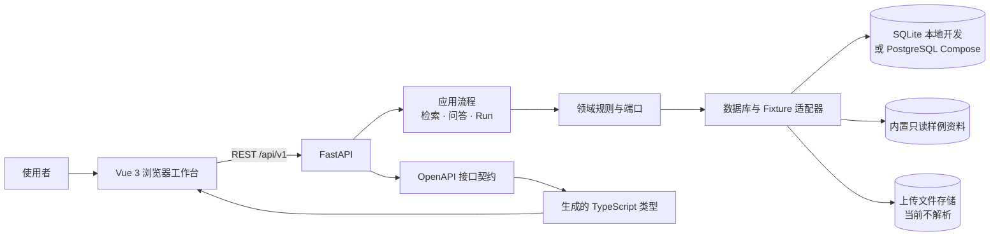

# 知引 · 企业知识工作台

这是一个可以在自己电脑上启动的企业知识库 RAG 工作台演示。你可以从内置样例开始，沿着“文档 → 检索证据 → Agent 回答与引用 → 运行记录”走一遍，了解一套知识问答系统的各个环节如何连接。

> **当前版本是 Stage A 演示版。** 它使用内置只读样例和固定的 Mock 流程，不会调用真实大模型、OCR 或向量数据库。上传文件目前只会经过格式校验并安全保存，**不会被解析或加入检索**。因此，页面中的检索分数和处理成功状态都不是生产质量或真实解析结果。

## 五分钟了解项目

- **你可以做什么：** 浏览示例知识库和文档、查看 Chunk、调试检索、体验带来源引用的 Agent 问答、查看每次操作的 Run 轨迹。
- **它适合什么：** 学习企业知识库 RAG 的主要组成部分，或了解本项目的前后端结构和 API 契约。
- **它还不能做什么：** 解析用户上传的文档、调用真实模型生成答案、构建向量索引或作为有认证和多租户能力的生产服务。

## 项目如何组成

浏览器中的 Vue 工作台通过 FastAPI 的 `/api/v1` 接口访问后端。API 根据应用流程和领域规则调用数据库、只读 Fixture 和文件存储适配器。OpenAPI 是前后端共用的接口契约，并用来生成 TypeScript 类型。



本地开发默认使用 SQLite；Docker Compose 演示使用 PostgreSQL。两种模式保存的数据相互独立。内置 Fixture 是演示检索和回答的资料来源，上传文件目前只保存在单独的上传目录中。

## 页面地图

| 页面 | 作用 |
| --- | --- |
| **知识库总览** `/` | 查看知识库、创建知识库、打开示例资料，以及查看最近的运行记录。 |
| **文档管理** `/knowledge-bases/:id/documents` | 浏览知识库中的文档；上传不超过 25 MiB 的 PDF、DOCX、Markdown 或 TXT 文件；启动固定的 Demo 处理轨迹。上传文件会显示为“已保存 · 尚未解析”。 |
| **Chunk 查看** `/documents/:id/chunks` | 检查 Fixture 文档的章节和文本片段。Stage A 上传的文件不会生成 Chunk。 |
| **检索调试** `/retrieval` | 输入问题并查看 Mock 检索返回的 Evidence、来源 Revision 和 Chunk。分数只用于演示。 |
| **Agent 问答** `/chat` | 向内置演示知识库提问，查看答案、Citation 来源和关联的 Run。 |
| **运行记录** `/runs`、`/runs/:id` | 查看检索、问答、上传和 Demo 处理轨迹的状态、事件与安全错误码。 |
| **模型与组件状态** `/providers` | 查看当前启用的 Mock 回答组件，以及尚未接入的文档解析、OCR 和向量存储。 |

## 几个名词，用简单话理解

- **RAG：** 先从资料中找相关内容，再根据找到的内容回答问题。这个项目用固定演示流程展示这条路径。
- **Fixture：** 项目预先放好的只读样例资料；当前演示检索和回答都使用它。
- **Chunk：** 为了检索而切分出的较小文本片段。
- **Evidence：** 检索时找到的资料片段及其来源信息。
- **Citation：** 回答里指向来源资料的引用。
- **Run：** 一次检索、问答或演示处理的运行记录，可查看状态和事件。

## 启动演示版（Windows，推荐）

### 需要准备

- 安装并启动 **Docker Desktop**（包含 Docker Compose）。
- 第一次启动会下载容器镜像并构建应用，耗时取决于网络；请保持终端打开。

### 启动

在 PowerShell 中执行：

```powershell
git clone https://github.com/Gydnaman/Enterprise-RAG.git
cd Enterprise-RAG
docker compose up --build
```

如果你已经下载过仓库，不必重复克隆；在项目根目录打开 PowerShell，直接运行 `docker compose up --build`。

等容器启动后，在浏览器打开：

- **操作面板：** <http://localhost:4173>
- **API：** <http://localhost:8000>

演示默认值已写在 Compose 配置中，直接体验不需要创建 `.env` 文件。这些默认值只供本机演示使用。首次启动会先准备 PostgreSQL 并更新数据库结构，再启动 API 和 Web；终端会持续显示服务日志。Web 和 API 只绑定到本机回环地址；PostgreSQL 仅供 Compose 网络内的服务使用。

### 停止

在运行 Compose 的终端按 `Ctrl+C`，然后执行：

```powershell
docker compose down
```

这会停止并移除容器，**保留** PostgreSQL 和上传文件的数据卷。不要使用 `docker compose down -v`，除非你确实要删除这些演示数据。

### 如果没有启动成功

在仓库目录下检查服务状态和日志：

```powershell
docker compose ps
docker compose logs -f api web migrate
```

先确认 Docker Desktop 正在运行；如果日志提示端口占用，请检查本机的 `4173` 和 `8000` 端口。首次构建期间可以在 `migrate` 服务日志中查看数据库初始化情况。

## 第一次打开后怎么操作

1. 在知识库总览中找到 **Demo Knowledge Base**，打开它的文档。这里的两篇 Markdown 文件是内置只读样例。
2. 打开 **检索调试**，尝试输入“上传文件会自动解析吗？”。查看返回的 Evidence，并留意它指向的 Revision 和 Chunk。
3. 打开 **Agent 问答**，提问“上传的文件会自动解析并进入检索吗？”。点击答案里的引用，沿着来源回看样例片段；再打开关联的 Run 查看流程记录。
4. 想了解上传页面时，可以上传一个小型 Markdown 或 TXT 文件。它会保存为“尚未解析”，不会出现在 Fixture 的检索结果中。
5. 打开 **模型与组件状态**，确认当前只有固定的 Mock 回答组件参与演示。

Demo 处理轨迹是预设流程：第一次尝试固定显示失败，重试固定显示成功。这里的“成功”只表示模拟 Run 结束，不表示上传文档完成了解析、切块或索引。

## 本地开发（SQLite）

如果你准备修改前后端代码，可不用 Docker，直接启动 API 和 Vue 开发服务器。需要 Python `3.13.15`、Node.js `24.21.0`、pnpm `11.19.0` 和 `uv`。

在仓库根目录打开 PowerShell：

```powershell
Copy-Item .env.example .env
uv lock --project apps/api
pnpm install
uv run --project apps/api --env-file .env alembic -c apps/api/alembic.ini upgrade head
uv run --project apps/api --env-file .env uvicorn rag_workbench.main:app --app-dir apps/api/src --host 127.0.0.1 --port 8000 --workers 1
```

保持 API 终端运行，再打开另一个 PowerShell 窗口：

```powershell
pnpm --dir apps/web dev
```

浏览器访问 <http://127.0.0.1:5173>。Vite 会把 `/api/v1` 请求转发到本机的 FastAPI。SQLite 数据保存在 `data/workbench.db`，上传文件保存在 `data/uploads/`。首次启动 API 时会按稳定 ID 写入演示 Fixture；数据库结构由 Alembic 显式创建。

## 开发者：API 契约与常用命令

FastAPI DTO 是 API schema 的来源。修改 API 后可以用以下命令导出契约并更新前端类型：

```powershell
uv run --project apps/api python -m rag_workbench.export_openapi
pnpm api:generate
pnpm api:check
pnpm typecheck
pnpm build
```

OpenAPI JSON：`docs/api/openapi.json`。生成的 TypeScript 类型：`apps/web/src/api/generated/types.gen.ts`。`/health/live` 用来检查 API 进程，`/health/ready` 检查数据库连接和 schema revision。

## 项目目录

```text
apps/
  api/       FastAPI、应用流程、领域规则、数据库和文件适配器
  web/       Vue 工作台、页面路由、API 客户端和生成类型
docs/
  api/       OpenAPI 契约
  architecture/  架构决策与设计
  specs/     Stage A 产品和行为边界
compose.yaml Docker Compose 本地演示环境
```

统一 Problem 响应包含 request ID 和安全错误码；服务端不会把本地存储路径、密钥或异常栈返回给浏览器。
